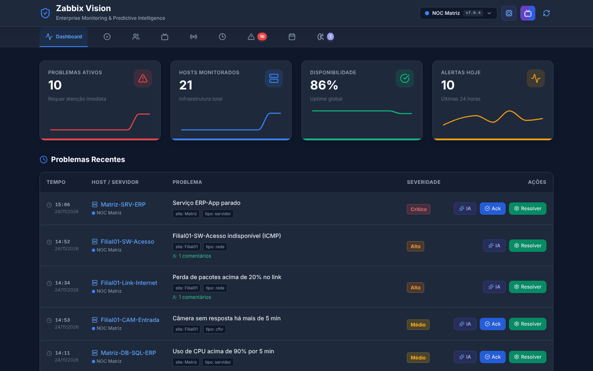
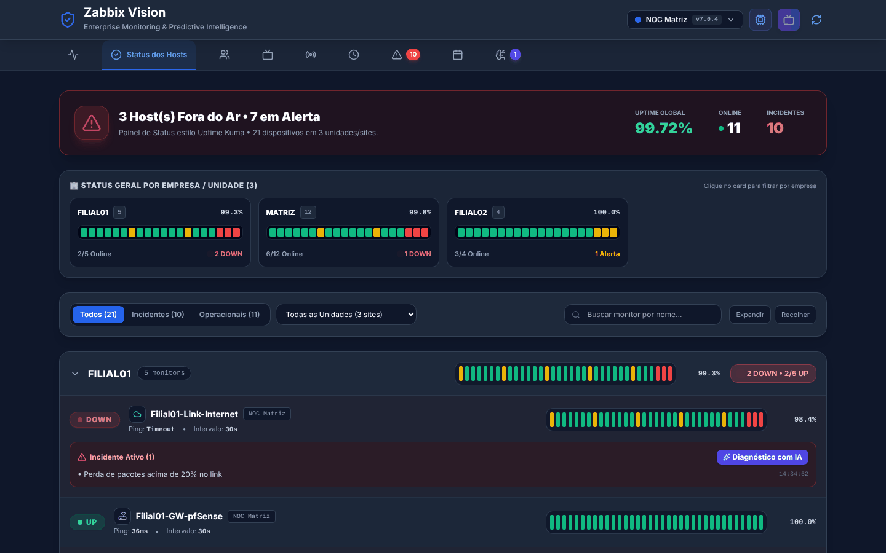
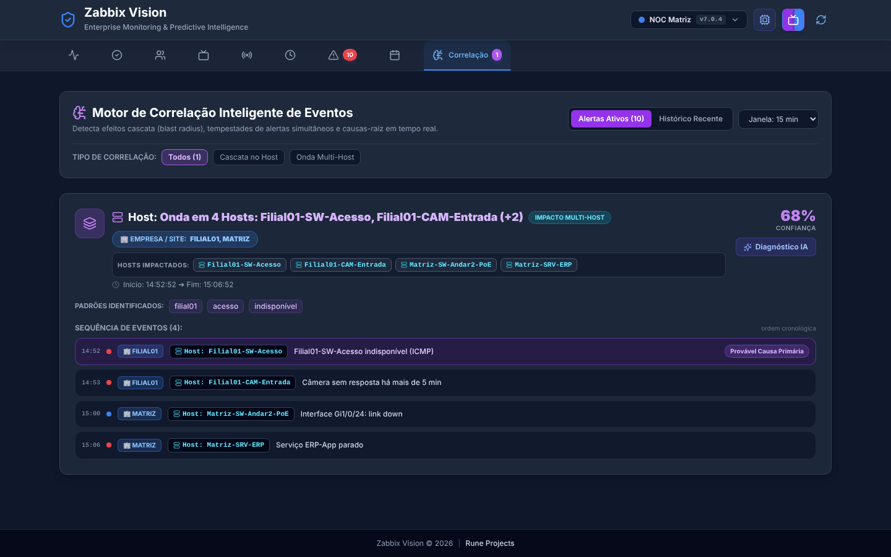
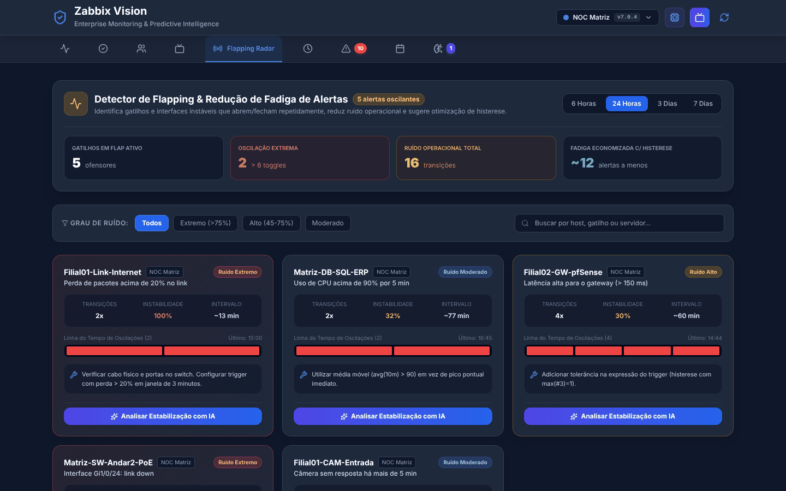
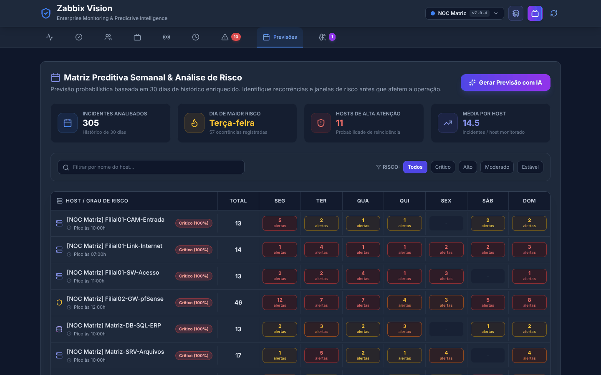

# Zabbix Vision

Um dashboard moderno para o **Zabbix**, focado em entender o que está acontecendo, e não só em listar alertas: topologia com impacto em cascata, detecção de flapping, correlação de eventos e previsão de incidentes.



## Sobre

O frontend padrão do Zabbix mostra muito problema e pouca explicação. Quando um switch de borda cai, aparecem dezenas de alertas a jusante e alguém precisa descobrir na mão qual é a causa. O Zabbix Vision organiza esses dados: mostra a topologia, aponta a causa provável, destaca os gatilhos que ficam oscilando e projeta onde o próximo incidente tende a aparecer.

## Funcionalidades

- **Mapa de topologia e impacto em cascata**: grafo de dependências (borda → switches → servidores → bancos → CFTV), com propagação de falhas e simulador de queda para ver o "raio de impacto"
- **Detector de flapping**: encontra gatilhos e interfaces instáveis, calcula o nível de ruído e sugere ajustes de histerese
- **Correlação de eventos**: agrupa efeitos em cascata no mesmo host e ondas simultâneas entre hosts, apontando a causa primária
- **Previsão de incidentes**: projeção semanal com base em 30 dias de histórico, com risco por host e horários de pico
- **Vários servidores Zabbix** (5.4, 6.0, 6.4, 7.0 e 7.2), separados ou numa visão unificada
- **Análise com IA**: Ollama local, Google Gemini ou um motor de regras offline, que funciona sem IA nenhuma
- **Operação do dia a dia**: dashboard em tempo real, linha do tempo, reconhecimento (ack) de problemas, filtros por tag e período e modo wallboard para NOC

## Telas

<table>
<tr><td width="50%" align="center"><br /><sub>Status dos hosts por unidade</sub></td><td width="50%" align="center"><br /><sub>Correlação de eventos com causa provável</sub></td></tr>
<tr><td width="50%" align="center"><br /><sub>Detector de flapping</sub></td><td width="50%" align="center"><br /><sub>Previsão semanal de incidentes</sub></td></tr>
</table>

## Requisitos

- Node.js 18+
- Acesso à API do Zabbix (token de API ou usuário e senha)

## Como rodar

```bash
git clone https://github.com/guilhermealceu/zabbix-vision.git
cd zabbix-vision
npm install
npm run dev
```

## Configuração

**Pela interface (recomendado):** clique em **Conectar Servidor Zabbix**, informe a URL da API (ex.: `https://zabbix.suaempresa.com.br/api_jsonrpc.php`) e o token ou usuário e senha, teste e salve. A conexão fica guardada no navegador.

**Por variáveis de ambiente:** copie `.env.example` para `.env`:

```env
VITE_ZABBIX_URL=https://zabbix.suaempresa.com.br/api_jsonrpc.php
VITE_ZABBIX_TOKEN=
GEMINI_API_KEY=   # opcional
```

## Estrutura

- `components/`: telas e componentes (topologia, flapping, previsão, timeline, wallboard)
- `services/`: comunicação com a API do Zabbix
- `server.ts`: servidor com as rotas de IA
- `App.tsx`: aplicação principal

## Autor

Criado por **Guilherme Dill** · [RUNE Projects](https://www.runeprojects.com.br) · [GitHub](https://github.com/guilhermealceu)

## Licença

[MIT](LICENSE)

<sub>Zabbix é marca registrada da Zabbix LLC. Este projeto é independente e não tem vínculo com a Zabbix.</sub>
